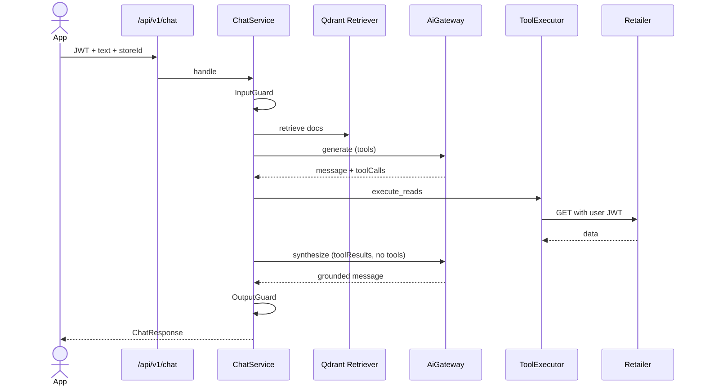
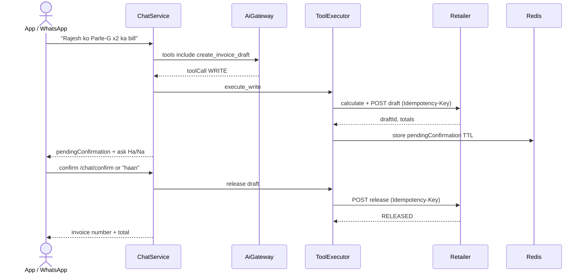

# 06 — Critical Data Flows (adapted to dragbizz-ai)

Product flows from `dragbizz-ai-service/DATA_FLOW.md`, re-routed through **ChatService / ToolExecutor / workers** in this repo.

---

## Flow 1 — In-app chat (current)

**Status:** Phase A1 synthesis shipped (`AI_CHAT_SYNTHESIS_MAX_TOKENS`; skip when no tools).

---

## Flow 2 — Draft invoice with confirmation (target)

**Rules:** GST/totals from retailer only; LLM never invents totals; release is SENSITIVE.

---

## Flow 3 — WhatsApp voice invoice (target)

1. Meta webhook → HMAC verify (`webhooks.py`).
2. Map `phone` → `{agencyId, storeId, sessionId}` (Postgres).
3. Ack 200 fast; enqueue worker job.
4. Download media → STT → text.
5. Call **same** `ChatService.handle` (system user token or internal tool path with store context).
6. Outbound reply via `UtilityClient` WhatsApp send.
7. Confirmation reply re-enters chat confirm path.

---

## Flow 4 — Image catalogue import (target)

1. `POST /imports/image` (JWT) → utility presign → store asset key.
2. Enqueue vision job → structured product rows + confidence.
3. Persist `ImportJob`; client polls.
4. Merchant edits/approves → retailer bulk create with idempotency.
5. Never auto-publish without approval.

---

## Flow 5 — Proactive low-stock / expiry (target)

1. Retailer emits domain event → RabbitMQ.
2. `app/runtime/events` consumer updates feature cache / triggers scan.
3. Alert dedupe hash in Postgres; notify via utility FCM/WhatsApp.
4. Optional: generate discount suggestion or PO draft (WRITE tool / API).

---

## Failure matrix (all flows)

| Failure | Behavior |
|---|---|
| Qdrant down | Chat without docs |
| LLM down | 502 `AI_PROVIDER_ERROR` |
| Retailer 403 | `toolResults.success=false` / `TOOL_FORBIDDEN` |
| STT low confidence | Ask repeat |
| Duplicate webhook | Idempotent job key |
| Confirm twice | Same release result |
| Offline client | AI features unavailable; POS unaffected |
